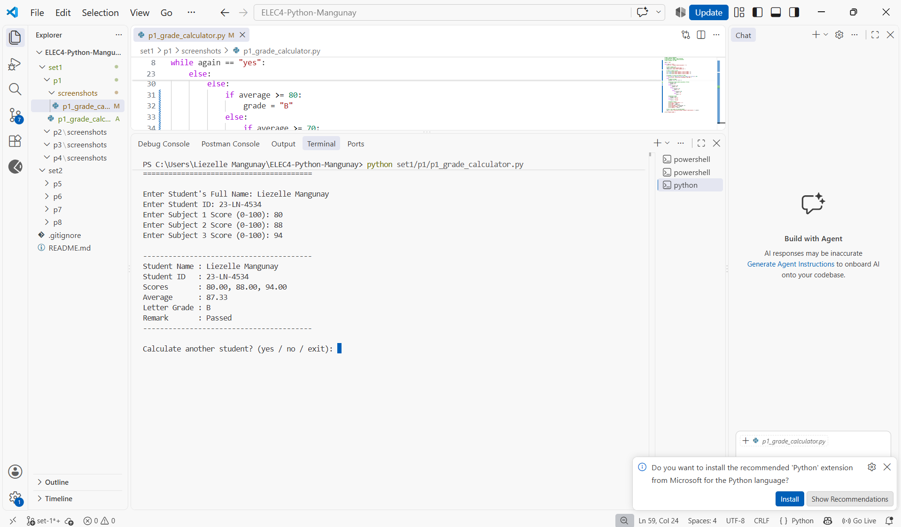
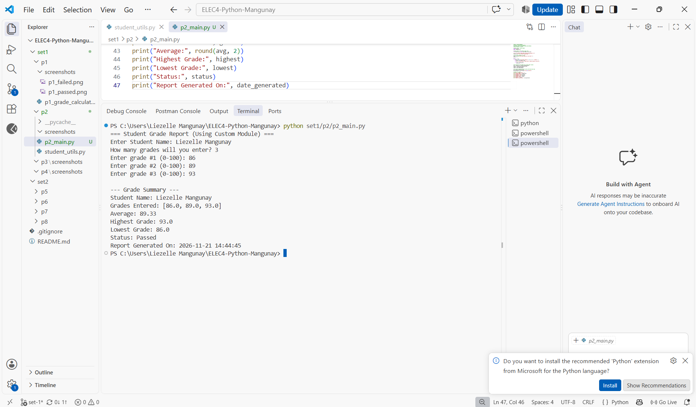
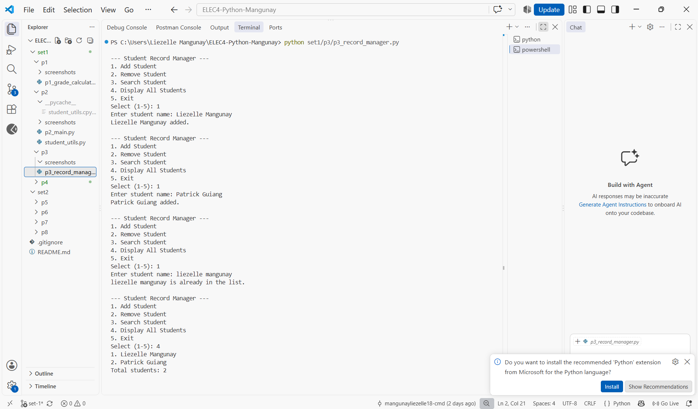
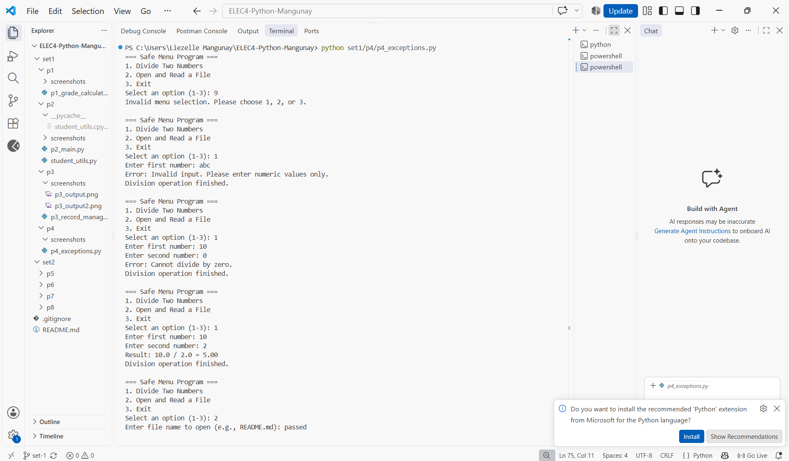

# ELEC4 - Python Programming Activities

- **Name:** Liezelle Mangunay
- **Course & Section:** IV-BSIT C
- **Course Code & Title:** ELEC 4 - Python Programming

---

## Repository Structure

### Set 1: Python Fundamentals, Modules, Data Structures & Exception Handling ([`set1/`](set1/))

| Activity | Folder | Description |
| :--- | :--- | :--- |
| **P1: Student Grade Calculator** | [`set1/p1/`](set1/p1/) | Computes student averages with input validation, letter-grade classification, and continuous loop support (`p1_grade_calculator.py`). |
| **P2: Custom Utilities Module** | [`set1/p2/`](set1/p2/) | Implements reusable helper functions in `student_utils.py` imported by `p2_main.py` to generate formatted student reports. |
| **P3: Student Record Manager** | [`set1/p3/`](set1/p3/) | Manages student records and unique subject enrollments using Python lists, dictionaries, and sets (`p3_record_manager.py`). |
| **P4: Safe Menu Program** | [`set1/p4/`](set1/p4/) | Demonstrates structured exception handling (`try-except-else-finally`) for invalid menu choices, non-numeric inputs, division by zero, and missing files (`p4_exceptions.py`). |

---

## How to Run

From the repository root directory:

* **P1: Student Grade Calculator** — `python set1/p1/p1_grade_calculator.py`
* **P2: Custom Utilities Module** — `python set1/p2/p2_main.py`
* **P3: Student Record Manager** — `python set1/p3/p3_record_manager.py`
* **P4: Safe Menu Program** — `python set1/p4/p4_exceptions.py`

---

## Sample Outputs (Set 1)

### P1: Student Grade Calculator

### P2: Custom Utilities Module

### P3: Student Record Manager

### P4: Safe Menu Program

